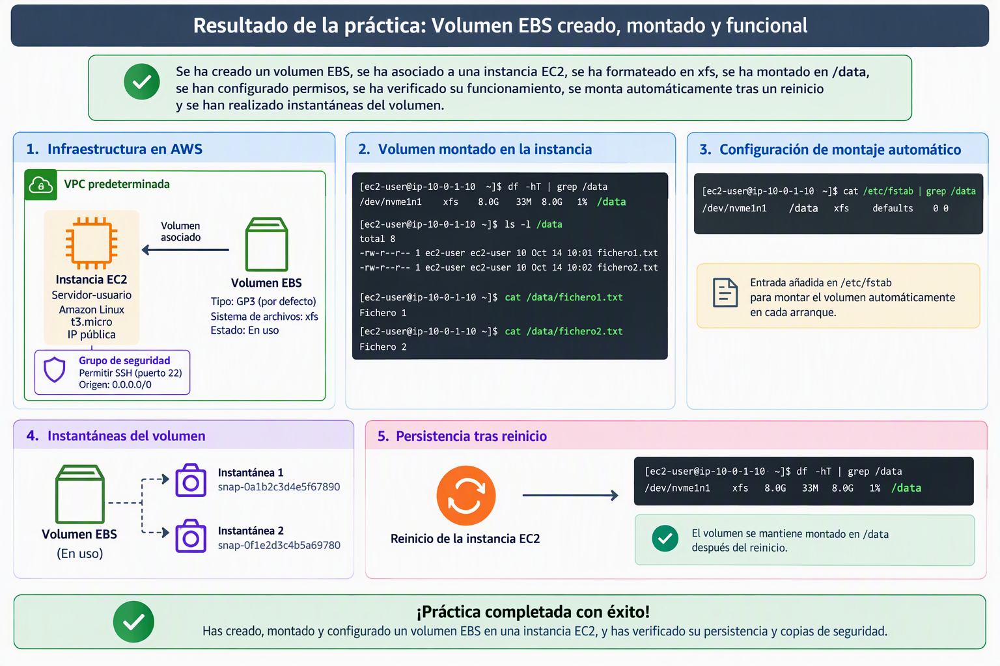

# Práctica 1: Creación y montaje de un Volumen EBS

Vamos a realizar una práctica en la que trabajaremos con varias fases del [ciclo de vida un disco EBS](https://docs.aws.amazon.com/es_es/ebs/latest/userguide/ebs-volume-lifecycle.html). crearemos una disco EBS que posteriormente agregaremos a una instancia EC2. Una vez vinculado el disco, le daremos formato y lo asociaremos a un punto de montaje. Modificaremos los permisos para que el usuario ec2-user tenga control completo sobre él. Una vez finalizada la operativa, modificaremos /etc/fstab para que el disco se monte automáticamente en cada arranque, haremos un par de instantáneas y restauraciones del disco y, por último, automatizaremos las instantáneas con una política de **Amazon Data Lifecycle Manager (DLM)**. Esta práctica se hará toda en la consola de AWS.



## Creación de instancia EC2

1. Cree una instancia EC2 en la Región us-east-1:
   - Nombre: `Servidor-$username`
   - AMI: Amazon Linux más actual que sea Apta para la capa gratuita
   - Instancia t3.micro
   - Utiliza el par de claves vockey
   - Establece la máquina EC2 en la VPC predeterminada. Sin preferencias en AZ y Subred.
   - Asignación automática de IP pública: Habilitar
   - Crea una regla de seguridad llamada Permitir SSH abriendo el puerto 22 a cualquier origen
   - Deja el almacenamiento y el resto de parámetros por defecto y pulsa el botón Lanzar instancia.

## Crear volumen EBS, asociarlo y montarlo

2. Siguiendo el siguiente [manual](https://docs.aws.amazon.com/es_es/ebs/latest/userguide/ebs-creating-volume.html) vamos a crear un volumen Amazon EBS desde la consola. Ignora los pasos 10 y 11 y posteriormente asocialo a la instancia EC2 creada en el paso 1.
3. Una vez creado el volumen y asociado, sigue el siguiente manual para dar [formato y montarlo](https://docs.aws.amazon.com/es_es/ebs/latest/userguide/ebs-using-volumes.html) en el sistema Amazon Linux. Haz que el sistema de archivos sea xfs y que el punto de montaje sea /data.
4. Una vez tengamos la carpeta montada vamos a dar permisos al usuario actual para que pueda trabajar con la carpeta:

```sh
sudo chown -R $USER:$USER /data
chmod 750 /data
```

5. Comprueba que puedes leer y escribir en la carpeta. Por ejemplo creando algunos ficheros de texto con comandos y luego leyéndolos.  Ejemplo:

```sh
echo "Fichero 1" > /data/fichero1.txt
echo "Fichero 2" > /data/fichero2.txt

cat /data/fichero1.txt
```

6. Siguiendo los [pasos del manual](https://docs.aws.amazon.com/es_es/ebs/latest/userguide/ebs-using-volumes.html), haz que el dispositivo EBS se monte automáticamente después de un reinicio.

7. Reinicia la máquina EC2 y comprueba que el dispositivo está montado en la carpeta /data y que puedes leer y escribir en dicha carpeta.

## Creación de instantáneas

8. Ahora vamos a realizar una instatánea del disco. Para ello detén la instancia EC2 y creamos la instatánea para ello puedes seguir el siguiente [manual](https://docs.aws.amazon.com/es_es/ebs/latest/userguide/ebs-create-snapshot.html). Nombra a la instántanea como "Instántanea inicial".

9. Arrancamos de nuevo la máquina EC2 y una vez arrancada creamos ficheros nuevos en la carpeta `/data` donde se encuentra montado nuestra unidad EBS.

```sh
echo "Fichero 3" > /data/fichero3.txt
echo "Fichero 4" > /data/fichero4.txt

#Listamos los 4 ficheros que existen en /data
ls -l /data
```

10. Creamos una nueva instántanea que se llame "Segunda instántanea"

11. Una vez finalizada la instantánea arrancamos de nuevo la máquina EC2. Nos vamos a la carpeta /data y la vaciamos borrando todo el contenido que está dentro de ella.

```sh
# Añadiremos el parámetro -r si dentro de /data tenemos carpetas
rm /data/* 
#Comprobamos que está vacía la carpeta
ls /data
```

## Restauración de instantánea

Vamos a restaurar el volumen a partir de la instantánea. Para ello tenemos dos métodos:

- Crear un nuevo volumen a partir de la instantánea y copiar el contenido al volumen actual.

- Crear un nuevo volumen a partir de la instatánea y sustituir el disco EBS.

Vamos a utilizar el **segundo método** para restaurar la "Segunda instantanea". Para ello seguiremos el siguiente [manual](https://docs.aws.amazon.com/es_es/prescriptive-guidance/latest/backup-recovery/restore.html#restore-snapshot) pero teniendo en cuenta lo siguiente. 

> Para poder desvincular el volumen desde la consola AWS, es necesario **realizar el paso de desmontaje (paso d) en primer lugar**. Recuerde que estamos sustituyendo un disco que no es raíz.

1. Una vez finalizada la sustitución de discos, monta el nuevo disco y comprueba que en data están los 4 fichero que creamos. 

2. Comprueba si ha cambiado el blkid comparando el id del disco que nos da el comando `blkid` con el UUID que tenemos en `/etc/fstab`. Si ha cambiado, modifica fstab para que el nuevo volumen se remonte.

3. Reinicia el sistema y comprueba que el nuevo volumen está montado.

## Automatización de instantáneas con Data Lifecycle Manager

Hasta ahora hemos creado las instantáneas a mano. En un entorno real las copias se programan: **Amazon Data Lifecycle Manager (DLM)** crea instantáneas automáticamente con la frecuencia que indiquemos y **borra las antiguas** cuando se supera la retención. DLM no elige los volúmenes por su ID, sino por una **etiqueta**: protegerá todos los volúmenes que la tengan.

Vamos a crear una política que haga una instantánea **cada hora** del volumen montado en `/data` y conserve **las 3 últimas**.

### Etiquetar el volumen

1. Ve a **EC2 → Elastic Block Store → Volúmenes** y selecciona el volumen que está montado ahora en `/data` (el que creamos a partir de la "Segunda instantánea").

2. Abre la pestaña **Etiquetas** y pulsa **Administrar etiquetas**.

3. Pulsa **Agregar etiqueta nueva** y escribe:
    - Clave: `backup`
    - Valor: `practica1`

4. Pulsa **Guardar**.

> Las etiquetas distinguen mayúsculas y minúsculas. Escribe la clave y el valor exactamente igual en el volumen y en la política.

### Crear la política de ciclo de vida

1. Ve a **EC2 → Elastic Block Store → Administrador del ciclo de vida** (*Lifecycle Manager*) y pulsa **Crear política de ciclo de vida**.

2. En **Seleccionar el tipo de política**, elige **Política de instantáneas de EBS** (*EBS snapshot policy*) y pulsa **Siguiente**. Si la consola te ofrece elegir entre una política predeterminada y una personalizada, elige la **personalizada**.

3. En **Recursos de destino**:
    - **Tipos de recursos de destino**: `Volumen`.
    - **Etiquetas de recursos de destino**: clave `backup`, valor `practica1`. Pulsa **Agregar** para que la etiqueta quede añadida.

4. **Descripción**: `Instantaneas cada hora - $username`.

5. **Rol de IAM**: elige **Elegir otro rol** y selecciona `LabRole`.

    > No elijas el **rol predeterminado**: la consola intentaría crear el rol `AWSDataLifecycleManagerDefaultRole` y el laboratorio no permite crear roles.

6. **Etiquetas de la política**: añade `Name` = `dlm-$username`.

7. **Estado de la política**: **Habilitar**. Pulsa **Siguiente**.

8. En **Configurar la programación**, rellena los **Detalles de la programación**:
    - **Nombre de la programación**: `Cada-hora`.
    - **Frecuencia**: `Diaria`.
    - **Cada**: `1 hora`.
    - **A partir de**: la hora actual **en UTC** más 5 minutos, en formato `hh:mm`. Recuerda que la hora peninsular española es UTC+1 en invierno y UTC+2 en verano: si en España son las 17:40 en noviembre, escribe `16:45`.
    - **Tipo de retención**: `Recuento`.
    - **Conservar**: `3`.

9. En **Etiquetado**:
    - Marca **Copiar etiquetas del origen**, para que las instantáneas lleven la etiqueta del volumen.
    - Pulsa **Agregar etiqueta** y añade `creado-por` = `dlm`.

10. Deja **desactivadas** el resto de secciones (archivado de instantáneas, restauración rápida, copia entre regiones y uso compartido entre cuentas): generan costes adicionales que no necesitamos.

11. Pulsa **Revisar política**, comprueba el resumen y pulsa **Crear política**.

12. En la lista del **Administrador del ciclo de vida**, comprueba que la política aparece con estado **Habilitada**. Si aparece en estado **Error**, revisa el rol de IAM y la etiqueta y avisa al profesor.

### Comprobar las instantáneas automáticas

1. DLM crea la primera instantánea **dentro de la hora siguiente** a la hora de inicio, así que puede tardar. Mientras tanto, responde en el fichero `respuestas-dlm.txt`:
    - ¿Cuál es el **RPO** (pérdida máxima de datos) que garantiza esta política?
    - ¿Hasta qué momento del pasado podríamos volver con 3 instantáneas cada hora?
    - ¿Qué cambiarías en la programación si la empresa pidiera poder recuperar cualquier día de la última semana con un RPO de 24 horas?

2. Pasado ese tiempo, ve a **EC2 → Elastic Block Store → Instantáneas** y filtra por la etiqueta `creado-por` = `dlm`. Debe aparecer al menos una instantánea del volumen. Haz una captura llamada `dlm-instantaneas.png`.

3. *(Opcional)* Si vuelves más de 3 horas después, comprueba que solo se conservan **3 instantáneas**: DLM ha borrado automáticamente las más antiguas.

### Eliminar la política

Cuando termines, elimina la política para que no siga creando instantáneas:

1. En el **Administrador del ciclo de vida**, selecciona la política y pulsa **Acciones → Eliminar política de ciclo de vida**.

2. **Eliminar la política no borra las instantáneas que ha creado.** Ve a **Instantáneas**, filtra por `creado-por` = `dlm`, selecciónalas y pulsa **Acciones → Eliminar instantánea**.

¡Felicidades! Has finalizado la práctica. 

Recuerda borrar todos los recursos creados para no consumir saldo de AWS
